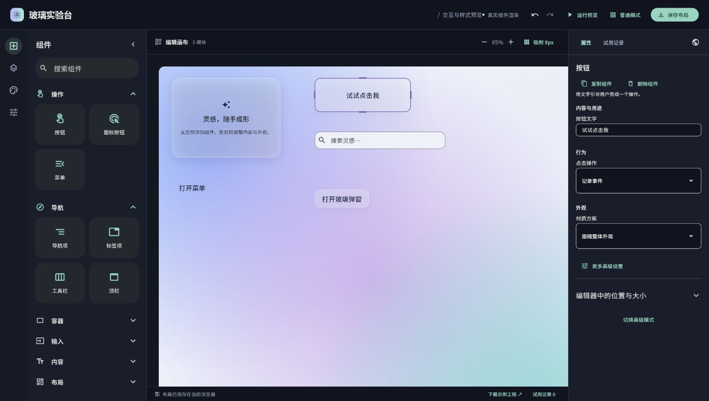
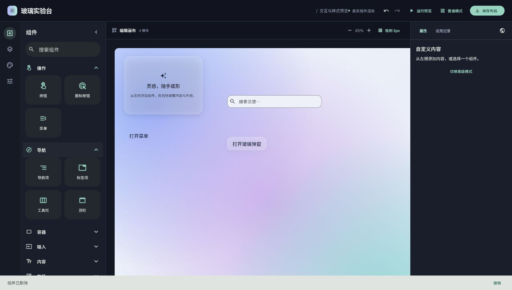
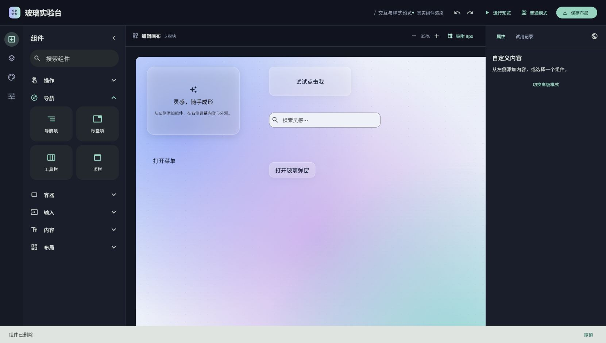
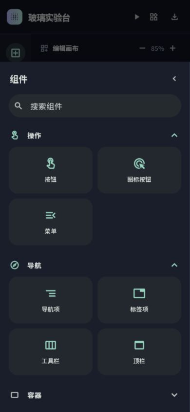

# 四边尺寸、拖动删除与侧栏状态验收

日期：2026-11-14。只修改deployment实验台，组件库与快照不变。旧布局不清空，旧失败日志保留。

## 当前契约

- 顶层按钮和图标按钮填满模块宽高，内容居中；新建分别为160×56、56×56，下限48×48。其他组件保持原来的内容区域与内部约束。嵌套按钮不强制拉伸。原有x/y/w/h保留，旧按钮原来空白的可用区域现在成为真实按钮表面。
- 选中后显示遵循材质圆角/形状的细轮廓，四条边中央有短手柄，没有右下角箭头。拖左/上边固定右/下边；缩放后的真实按钮与外框一致。画布和独立运行共用呈现规则，去掉运行预览残留的28像素标题偏移。
- 拖动组件时左栏覆盖为删除区域，进入后提示“松开即可删除”。只有在区域内释放才删除；移回画布不删除；系统取消则恢复原位置。一次移动、缩放或删除只记一条历史；撤销恢复位置/内容，重做再次删除。输入资源随删除释放。
- 左栏灰屏已复现：滚动列表的double偏移被折叠项当作bool读取，抛出类型异常。为折叠项设置独立PageStorageKey，列表滚动、折叠、搜索和导航状态不再串用。

## 自动化与真实页面

| 项目 | 结果/证据 |
| --- | --- |
| 灰屏原始复现 | sidebar-before.log保留double→bool异常；sidebar-fixed.log与sidebar-final.log通过八轮切换、滚动保持、搜索、折叠、收起与展开 |
| 四边尺寸 | resize_handles_test.dart覆盖40/85/125%画布、四边位置、实际按钮尺寸、对边固定、撤销、取消、48最小尺寸、运行位置/尺寸一致 |
| 拖动删除 | drag_delete_test.dart覆盖释放前不删、区域内删除、取消/移回不删、撤销/重做、390宽200%字与输入资源释放 |
| 完整回归、正式构建 | 格式24文件0更改；app分析0问题；140/140通过（含旧中文5宽度×3字号矩阵、减少动画、高对比度、参数/资源回归）；build.ps1成功 |
| 浏览器中文排版与真实操作 | Edge正式产物：按钮右/下边拖动后真实表面变大，文字居中；5→4模块删除，撤销恢复5模块；折叠/导航多次切换及滚动后面板正常；390×844重新加载后的中文面板双列可读 |

原始日志位于component-lab-site/artifacts/controls/，失败记录保留，不用修改旧视觉基准消除失败。

## 交付与边界

- EDIT-A 独立PR：[#12](https://github.com/surface-user/Flutter_liquid_glass/pull/12)。EDIT-B独立PR：[#13](https://github.com/surface-user/Flutter_liquid_glass/pull/13)。其独立分支分析0问题、17项专项通过。EDIT-C独立PR：[#14](https://github.com/surface-user/Flutter_liquid_glass/pull/14)，独立分支分析0问题、删除/侧栏4项通过。
- 本地验收、CI、人工审查与Sites发布分别记录。源库的真机性能、物理IME及未检查浏览器不在本轮通过范围；不修改依赖、公共API、快照或现有视觉基准。

## 页面证据与已知检查边界

- 64个保护文件SHA256完全一致。下载源码ZIP共61文件，与当前源码逐文件一致。
- 浏览器批量切换脚本曾超时中断，恢复后确认页面正常；八轮状态与滚动保持的可复现证明以sidebar_storage_test.dart为准，不把中断脚本声称为完整通过。
- 窄屏覆盖调整后CanvasKit首帧沿用旧像素密度，重新加载后按390×844正常呈现；证据为重新加载后的实际画面。
- Web构建有既有CupertinoIcons未提供字体提示，当前站点使用Material图标，已检查四边手柄与删除等图标正常；没有添加字体或依赖。
- PR #12精确head的视觉、分析、库/示例测试和Web构建通过；库包发布检查仍因根gitignore忽略deployment退出65。所有PR待非作者审查，不合并，不修改根配置绕过检查。

## Sites交付

原项目及公开受众保留。原站第**5**版于2026-11-14发布成功，返回终态`succeeded`。

- [原站点](https://liquid-glass-component-workbench.marseille-cjh.chatgpt.site)
- 推送且构建对应源码：`98304dca1077915aecc04c9e2724ee0b7724c083`。
- 发布归档：deployment/editor-controls-verified.tar.gz，36文件，SHA256 `b3d1a85a094d0d2992b8a314b9462b07c3cd4e4ca336eb194019431210a5ddff`。
- deployment ID：`appgdep_6af858f663ac81918cf757bc1c9fb4dc`。
- #12 head ac3af517、#13 head 385934db的根视觉/格式/分析/库与示例行为/Android Dart编译/Web构建均通过；仅库包pub发布检查失败，沿用既有根忽略规则门槛。#14最终head CI另列。全部PR为草稿，未合并；非作者审查未完成。
