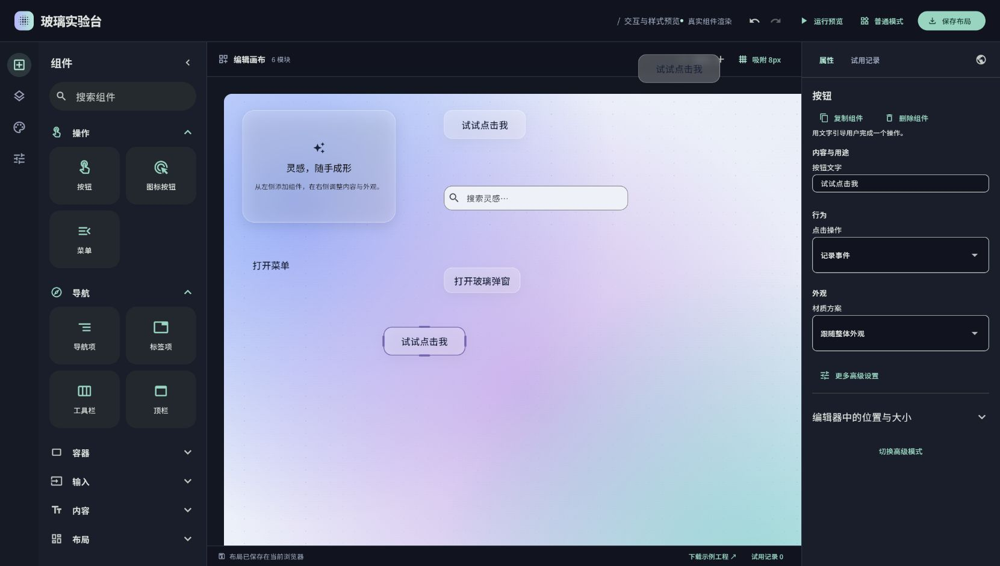
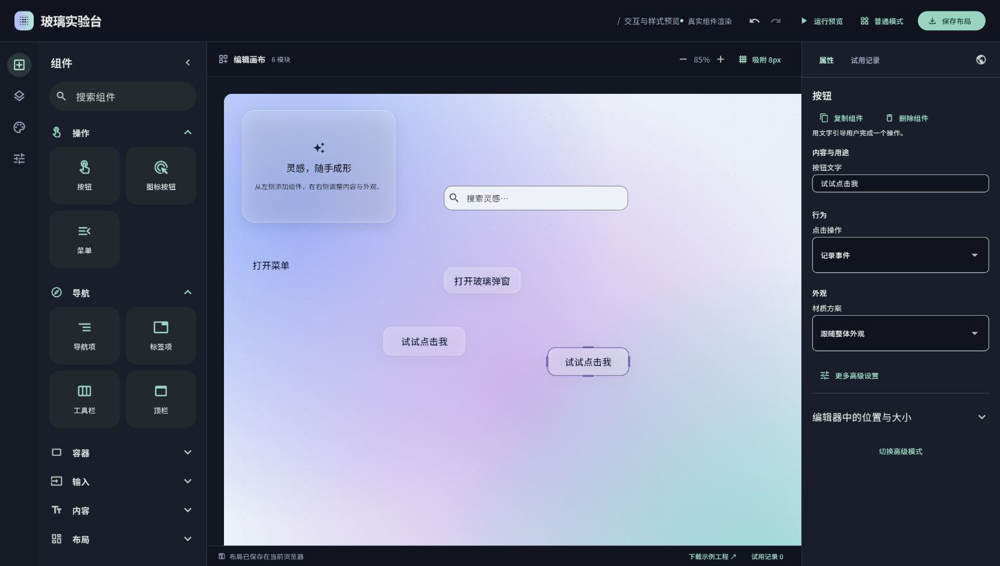

# 全页拖动反馈与按区域删除验收

日期：2026-11-14。基于原站第6版，只修改deployment；不改源库、快照、依赖或原有失败产物。

## 行为与范围

- 从组件库拖出的是按当前外观/画布缩放呈现的真实组件预览，使用根浮层，能跨过顶栏和右侧属性区。已有组件移动时也有全页预览，原位置内容变淡作为参照。预览140毫秒轻微提起，减少动画时立即呈现。
- 删除区仅在移动已有组件且指针进入左栏时出现，移出马上收起；点击、选中、画布内移动和从库拖出都不显示“拖到这里删除”。区域内释放删除，取消/撤销保持原规则。
- 全页自由跟随的是拖动预览；永久设计位置仍属于1200×1200画布，保持边界、缩放和8像素吸附。左库拖动的抓取点统一为距预览左上16×16屏幕像素，落点按此换算，不以自动排布替代真实落点。
- 浮动预览使用独立Runtime，不能抢焦点、执行操作或污染设计输入；其内部背景动画关闭，结束释放资源。提起动画动态响应减少动画与主题性能开关，销毁后无持续ticker。
- 窄屏组件面板在拖动时隐藏，保留活动手势，结束后再关闭；不能直接导航返回取消当前指针。透明遮罩下手动核对可见画布落点，取消不添加，也避免重复添加。

## 检查与原始失败

| 检查 | 结果 |
| --- | --- |
| 原始复现 | before.log两项失败：画布内移动就显示删除，左库只有文字反馈而无真实组件 |
| 初轮接线 | 缺少浮层Material、测试ValueKey类型不一致，记录first.log；修复后原导航/删除专项通过 |
| 窄屏/资源补验 | 导航pop会取消活动指针，改为隐藏面板，结束再pop；Runtime.dispose会释放但保留映射，测试改为验证控制器已不可监听，未修改资源释放实现；记录fixed.log |
| 专项 | fixed-2.log四项通过：全页位置、进入/移出提示、左库精确落点、窄屏拖出与减少动画/资源释放；最终扩展取消与主题开关后纳入完整回归 |
| 完整回归与格式/分析 | all-tests.log完整146/146通过；28文件格式0更改；app分析0问题，独立PR分支分析/12项专项通过 |
| 正式Web/浏览器/中文排版 | build.ps1成功；桌面Edge目录拖出、顶栏预览、画布内移动无删除提示、左栏删除及撤销通过。续验390×844：按钮2→3添加一次，拖回左栏3→2，顶部撤销2→3、重做3→2、再撤销恢复3；中文与面板隐藏正常 |

日志：component-lab-site/artifacts/free-drag/。既有五档画布移动/尺寸、参数、生命周期、高对比与中文矩阵保留；目录落点断言只更新为新明确抓取点，精度没有降低。

## 交付

DRAG-A实现/主验收/独立PR/CI/站点发布分别记录。物理IME、真机与未验浏览器不声称通过。根库包发布既有deployment忽略规则门槛不越界修改。

## 续验与证据

上轮中断保留实现和失败日志。本轮没有修改应用代码；核对正式产物下载ZIP65文件与当前源码逐项一致，64个源库/快照/历史失败保护文件SHA256不变。146项与独立分支12项沿用同一源码的已完成记录，没有用中断代替完成或无故重复。

独立[PR #17](https://github.com/surface-user/Flutter_liquid_glass/pull/17)，基于#16。代码head d84b3cb8e50e15256d12277d2dbde662d2eb2c05的格式/分析/库与示例行为/Android Dart编译/Web/视觉通过，仅库包发布检查失败，最终文档head检查另列。PR未合并，非作者审查未完成。

## Sites发布

本地和浏览器复验已通过，保留原项目和public受众，正在同步源码并发布；精确SHA及终态另行追加。浏览器验收基于本地正式产物，不声称已完成线上浏览器复验。正式构建既有CupertinoIcons缺字体提示保留，当前Material图标实测正常。
