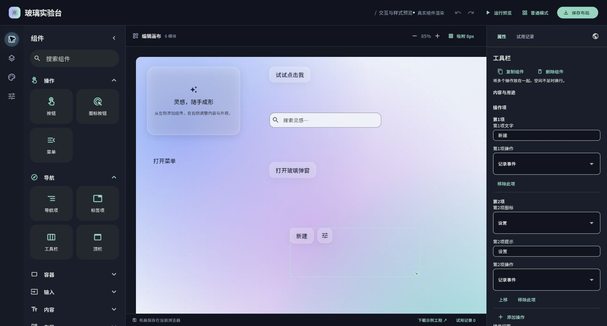
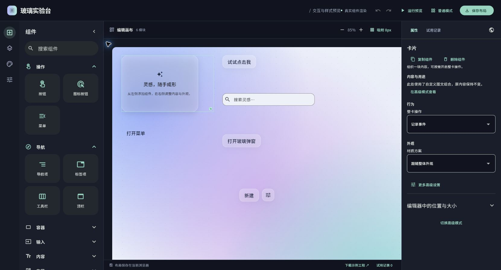
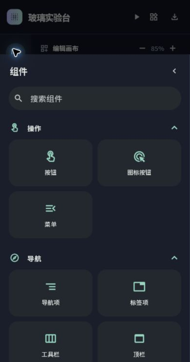

# 简洁导航与无标题画布验收

日期：2026-11-14。依据本轮参考图与用户要求。修改范围仅 `deployment/`；源组件库、快照、原有失败证据不变。任务状态见 [task.md](task.md)。

## 实际变化

- 左侧为窄图标栏与可收起面板，提供组件、图层、外观/动效、属性入口。
- 组件按操作、导航、容器、输入、内容、布局分组，可折叠、搜索；双列图标卡片，大字体/窄可用宽度改为单列。搜索单项仍按网格左对齐。只使用已有14种用途，不伪造参考图中的FAB等未实现类型。
- 图层列表显示组件名称与序号，可以定位无标题的画布对象。窄屏以面板呈现，点击添加后返回画布。
- 画布组件无常驻标题条、名称、复制/删除按钮或填色外框。选中才有1像素细轮廓与小缩放点；点击空白取消选中后编辑提示全部消失。复制/删除留在属性面板，组件名称可从图层和属性查看。
- 普通编辑直接拖动内容即可移动；原有参数编辑方式保留小拖动柄以兼容真实控件操作。两种编辑方式共用简洁用途目录，本轮未重写完整属性编辑流程或删除复杂旧布局。
- 模块原w/h、x/y保留，内容从原点占用整个可用框；校验移除已不存在的标题/边框预留，内部表面仍不能超出外框。
- 拖入画布按真实落点逆变换到画布坐标，支持缩放、吸附及边界限制，修复旧自动摆放导致重叠的问题。点击添加仍使用默认位置，重叠时可拖动或通过图层选取。
- 旧内置“拖动模块标题”说明仅在显示时转换为新提示，不重写保存JSON；新布局使用更新后的示例文字。

## 测试与构建

| 检查 | 结果 |
| --- | --- |
| 格式/静态分析 | 21个Dart文件格式检查通过；最终完整回归前flutter analyze无问题 |
| 完整回归 | **133/133通过**：原125项+导航5项+无标题画布3项 |
| 导航 | 两列实际位置、折叠项搜索/无结果、收起/恢复、图层选择不改JSON、真实拖放新增；5宽×3字体搜索/添加可用 |
| 拖放 | 40%/85%/125%实际屏幕落点断言，超出边界时安全限制；未仅检查“数量增加” |
| 无标题 | 两种编辑方式均无画布“工具栏”标题；真实GlassToolbar与模块原点重合；取消选中后轮廓/缩放点消失 |
| 尺寸/资源兼容 | 原拖动/缩放/撤销、菜单弹窗、内部尺寸、类型切换、运行隔离与无障碍回归保持；120×90表面可使用完整120×90外框 |
| 中文排版 | 普通14×5宽×3字体=210视图；高级22×5×3=330视图；导航另覆盖320/390/820/1180/1500×100/130/200%字体 |
| 追加对齐修正 | 全量之后修正单搜索项居中，5项导航专项再次通过，新增实际左边界断言；未改交互/数据协议 |
| 正式Web | `build.ps1`通过；最终构建日志`build-accepted.log`；本地CanvasKit与中文/Material字体正常 |
| 下载包 | 最终ZIP的56个源码、资产和配置文件与当前文件逐字节一致 |
| 保护边界 | 64个根库/快照/已有失败文件哈希不变；源库原工作分支与未跟踪文件保持 |

本地证据位于 `deployment/component-lab-site/artifacts/navigation/`：`analyze-final.log`、`tests-final-drop.log`、`catalog-alignment.log`、`build-accepted.log`、`source-archive-match-final.json`。第一次检查中的不存在图标/样式字段、320宽130%工具栏溢出、旧落点行为与测试动态ValueKey定位错误均保留原记录，未删断言/覆盖失败。

## 浏览器实操

Windows Edge 从独立回环地址打开正式构建，避免改变原线上地址的浏览器布局。已操作：

1. 新导航的双列组件卡片、分组、收起/恢复。
2. 拖工具栏到画布指定位置，位置跟随；直接拖动内容移动，再操作缩放点。
3. 点击空白，画布只保留真实内容；从图层重新选取工具栏，属性正确定位。
4. 390×740首次加载、打开组件面板、输入中文搜索、关闭面板；临时视口已恢复。
5. 最终版本重新加载后截图目检，捕获的error日志为空。新旧浏览器场景均未清空布局。

## 独立PR与限制

- UI-A：[PR #10](https://github.com/surface-user/Flutter_liquid_glass/pull/10)，base为原P0验收PR #9；拆分分支自身分析及5项导航专项通过。
- UI-B：单独提交画布、尺寸契约与验收记录，链接由任务账本维护。
- PR均不自动合并，等待非作者审查。根CI沿用已有门槛：库包dry-run会因根gitignore忽略已纳入评审的deployment文件而报警。本轮不修改用户禁止的根配置、不绕过CI；网页发布与Flutter库包发布分开。
- 物理中文IME、真实手机/Android性能与其他浏览器未验；UI截图不替代全部参数组合检查。SDK仍提示未提供Cupertino字体，本网页使用Material图标，浏览器已核对，未添加无用依赖。

## 原站点

保持原项目ID与受众；待精确源码同步、保存并发布后追加最终结果。
