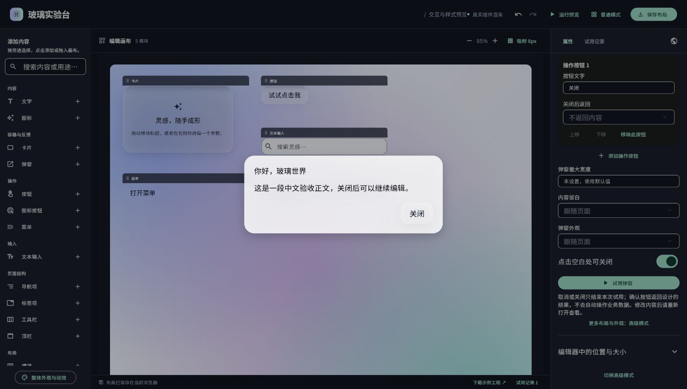
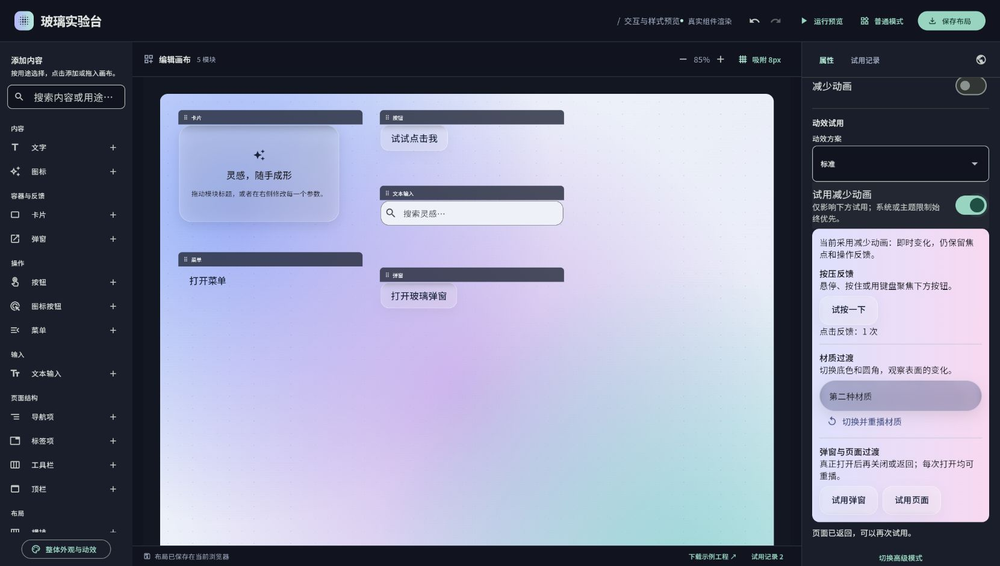
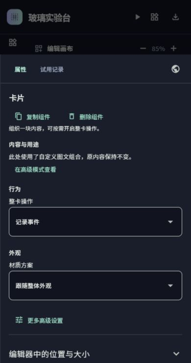

# P0 用途编辑、弹窗与动效验收

日期：2026-11-14。依据：[任务账本](task.md)、[差距分析](liquid-glass-vs-m3e-canvas-gap-analysis.md)及外层组件参考手册。主 Agent 集成验收，三个子 Agent 分别负责分类、弹窗、动效，并交叉阅读实现。只修改 `deployment/`，本轮不开发源组件库接口，不实施 P1/P2。

## 1. 实际交付

| 任务 | 用户可见结果 | 独立评审 |
| --- | --- | --- |
| 基础与计划 | 将原独立网页的必要基线纳入 deployment 评审路径，建立依赖/状态/验收账本 | [PR #5](https://github.com/surface-user/Flutter_liquid_glass/pull/5) |
| P0-A | 普通模式按用途提供14项，隐藏底层类型；高级模式保留22项；直接编辑常用内容/外观；新卡片默认静态；复杂旧结构保留 | [PR #6](https://github.com/surface-user/Flutter_liquid_glass/pull/6) |
| P0-B | 普通弹窗直接编辑入口、用途、标题正文、按钮/返回结果、尺寸/外观，提供只读预览和真实试用 | [PR #7](https://github.com/surface-user/Flutter_liquid_glass/pull/7) |
| P0-C | 独立运行、重置/退出/返回；标准/轻柔/快速真实动效试用；减少动画与高对比继承 | [PR #8](https://github.com/surface-user/Flutter_liquid_glass/pull/8) |
| P0-V | 最终接线、完整回归、中文矩阵、浏览器、正式构建与本记录 | 另列于任务账本 |

各 PR 按依赖堆叠，分别评审各自增量，不自动合并。任务 DONE 表示实现、主 Agent 本地验收和 PR 交付完成；CI、非作者审查、站点发布分别记录。

## 2. 普通模式的职责与边界

| 用途 | 本轮普通编辑/真实交互 | 复杂设置 |
| --- | --- | --- |
| 文字 | 内容、字号、对齐，原排版与节点身份保留 | 更多文字样式进入高级 |
| 图标 | 图案、大小 | 自定义颜色/复杂样式进入高级 |
| 卡片 | 简单文字、静态/记录事件、常用材质 | 旧图文组合和旧弹窗不重写，明确高级编辑 |
| 弹窗 | 独立入口，完整说明/确认流程；不让用户挑选底层表面/主题/路由 | 自定义标题/正文/操作结构明确保留并进入高级 |
| 按钮/图标按钮 | 文字/图标/提示、操作、材质；选择弹窗后进入专用编辑器 | 专用旧动作保留 |
| 菜单 | 入口文字、允许打开、条目文字/动作、增加/移除/重排；运行中是真菜单 | 旧条目弹窗明确高级编辑，不新增未完成的普通弹窗候选 |
| 文本输入 | 单行初值、提示、标签/辅助/错误、启用/只读；运行草稿可重置 | 不伪造库未开放的多行/密码能力 |
| 导航项/标签项 | 文案、设计选中、已适配操作；标签关闭回调与删除分开 | 绑定/页面管理等旧专用操作保留并提示 |
| 工具栏/顶栏 | 适配条目的内容、顺序、移除与高度/标题，窄屏操作保留 | 自定义组合进入高级 |
| 横排/竖排 | 间距、对齐；竖排长内容滚动 | 自定义子项、结构增删进入高级，不能悄悄扁平化 |

普通画布只选择/拖动/调整设计，内容不抢焦点、不产生运行事件、无闲置动效；真实交互使用“运行预览”。位置/宽高收在“编辑器中的位置与大小”，仍指模块外框；底层表面内部尺寸与约束继续由高级模式提供。旧高级类型切回普通模式保持原数据。

## 3. 验收结果

环境：Windows，Flutter 3.47.1 / Dart 3.13.1。所有 Flutter 命令串行。

| 检查 | 结果/可观察证据 |
| --- | --- |
| 格式与分析 | 19个Dart文件格式检查通过；`flutter analyze --no-pub`无问题 |
| 完整回归 | **125/125通过**：既有75、分类14、弹窗19、动效8、主集成9 |
| 高级兼容 | 原宽高实测、484种根类型转换、参数样例/合法插槽、控制器/焦点生命周期、菜单弹窗/路由、主题降级等75项保留 |
| 普通中文矩阵 | 14用途×320/390/820/1180/1500宽×100/130/200%字体，共210视图；高级22×5×3共330视图 |
| 下拉可读性 | 320宽200%选中文字的实际字形盒四边在控件内；标签移到框外、自然高度、完整换行，不能只凭没有overflow异常认定通过 |
| 弹窗 | 说明/确认切换前明确替换按钮；标题可空、长正文、操作增删重排、文本/数值/布尔/无返回结果；真实按钮/遮罩/Esc关闭、重复打开、焦点恢复 |
| 旧数据 | 稀疏默认值按真实类型读取、显式null、null操作列表、拒绝保存不改局部状态；旧内置文字仅翻译显示，不重写JSON |
| 独立运行 | 输入/计数/内页重置，系统返回先退内页，退出不改设计JSON，释放运行资源且无持续调度；启动前提交当前未回车输入 |
| 动效/无障碍 | 实际按压缩放、材质前后状态、真弹窗/页面路由、方案/重播；动态系统减少动画与主题限制生效；深色宿主/浅色设计及高对比实际前景/透明度/字号断言 |
| 正式构建 | `build.ps1`通过，CanvasKit随站点托管；下载ZIP的54个源码/资产/配置文件与当前本地文件逐字节一致 |
| 修改边界 | 开始前记录的64个根库、快照、既有失败文件SHA256全部不变；根工作分支与原有未跟踪文件保持 |

核心日志在 `deployment/component-lab-site/artifacts/p0/`：`analyze-final.log`、`tests-acceptance.log`、`build-final.log`、`source-archive-match.json`、`boundary-final.json`。这些是原始本地证据，未把所有历史产物上传PR。

## 4. 正式网页的浏览器实操

Windows Edge 从独立回环地址打开正式 `dist`，HTTP 200。测试布局与原线上地址的浏览器存储分离；未清空用户布局。

1. 普通目录/中文属性真实显示，图标正常；画布点弹窗只选中，右侧出现用途编辑。
2. 注入中文正文，失焦后只读预览更新；真实试用显示同一正文，Esc关闭并显示“已关闭，未返回结果”。
3. 独立运行输入中文临时草稿，点击重置恢复设计初值；菜单打开正确中文弹窗、关闭、退出运行回到设计。
4. 整体动效真实点击使反馈次数变为1，材质切换至第二种；进入动效页面并返回，界面显示可再次试用；减少动画开关显示即时变化说明。
5. 390×740首次加载与属性面板目检通过；临时浏览器尺寸已恢复。视口模拟调整后需重新加载以稳定Flutter首次布局，此处不声称覆盖真实窗口连续缩放。
6. 本次操作捕获的浏览器 error 日志为空。截图已实际查看；这不是所有浏览器均无错误的保证。

自动化28张普通组件截图位于本地 `artifacts/p0/screenshots/`，首轮与最终矩阵均保留。测试环境未载入Material图标字体，方框不代表正式网页图标缺失；正式浏览器已核对。

## 5. 失败修正与未完成门槛

保留首轮日志：新增入口button漏中文映射；弹窗试用焦点/Esc；稀疏默认与拒绝保存共享引用；深色宿主文字继承；颜色构造的浮点比较；下拉大字裁切；集成点击时滚动未稳定造成未命中。修正后完整重跑125项通过，没有删掉原断言或更新图像基准掩盖问题。

GitHub PR #6/#7/#8 当前精确head的根CI：分析、库/示例测试、profile Dart编译、示例Web构建、视觉回归、PR标题和依赖检查均通过；最后 `flutter pub publish --dry-run` 仍因**根.gitignore忽略整个deployment，但PR需要纳入这些文件**而警告并退出65。尝试deployment内pubignore无效，已移除。解决该门槛涉及用户禁止修改的根配置，本轮不修改、不合并、不绕过失败检查。网页包构建和Sites更新不等于Flutter库包发布。

根CI曾先因嵌套app未解析依赖而出现168项引用错误，已在deployment增加分析边界并为app提供独立规则：隔离目录根分析0问题；app分析0问题；临时undefined探针确实被app分析捕获，随后移除。没有把app本地分析关闭。

非作者人工审批、物理中文IME组合、Android真机性能、其他浏览器、所有材质/参数/嵌套组合未验。正式构建沿用SDK的Cupertino字体提示；本应用只用Material图标，未为提示添加无用依赖。

## 6. 原站点发布

原项目ID与受众保持，源码认证已恢复。**第3版已发布成功**，原地址：[玻璃组件实验台](https://liquid-glass-component-workbench.marseille-cjh.chatgpt.site)。保持服务当前返回的public受众，没有修改分享权限。

- Sites精确源码提交：`d8d6438280695cb2e13af25bbbad902c65f0eb15`，官方助手已提交/推送，再由该状态打包。
- 保存版本：`appgprj_6af48936adf081919aca29e5c9d758d4~appgver_24513293dc7481918ad0caec691387bd`。
- 发布：`appgdep_6af827ac02e08191851f2030d6a0dd2c`，服务终态`succeeded`，UTC 2026-11-14 09:20:08。
- 包SHA256：`625c77aeb2f0ad534879ef42a8a1d3dc4e26b3ef99a1ae80a002ebdd4fe791e0`。详细无凭据结果另存本地`artifacts/p0/publication.json`。

浏览器实操针对本次正式构建；线上发布由服务成功终态确认，没有另声称线上所有操作重新手验。
