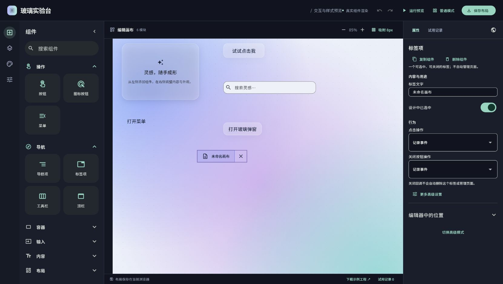
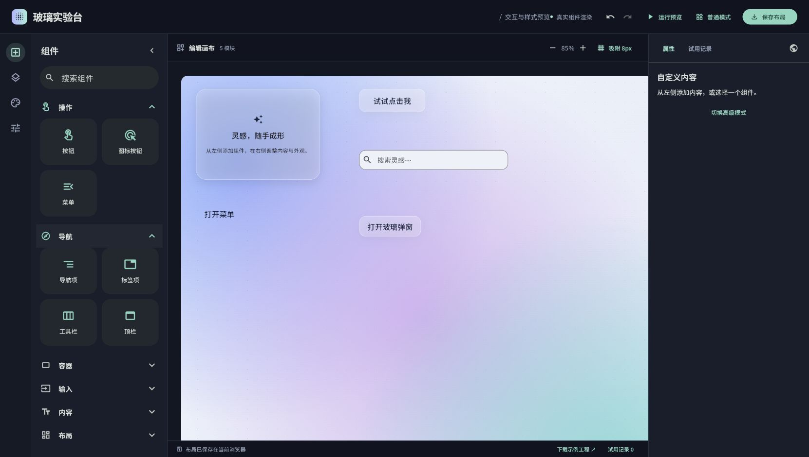
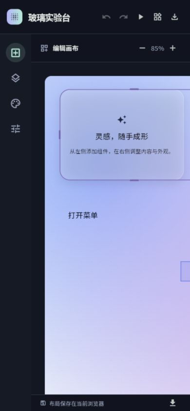

# 内容选框与顶部历史操作验收

日期：2026-11-14。基于已发布第5版，所有源码、测试、记录及证据只在deployment；源组件库、快照、依赖和既有失败文件保持不变。

## 行为

1. 标签项、导航项、菜单、弹窗入口、页面入口、文字、图标、菜单项由内容决定实际大小。选框和拖动命中区域跟随实际内容，标签关闭按钮也包含在内，不圈出360×110等预留空白。
2. 上述自然尺寸项在普通模式只显示位置和“尺寸随内容自动调整”说明，不再放出无效四边尺寸手柄。高级模式保留原始可用宽高及旧JSON；不做强制迁移或清空。按钮和容器继续使用原尺寸/四边手柄。
3. 撤销与重做使用运行预览左侧的一组紧凑图标，禁用状态可区分，中文悬停/辅助说明保留。窄屏也提供两个入口；320宽减少间距并收起装饰标志。
4. 拖入左栏后释放仍删除；取消不删、移回保留、资源随删除释放。删除完成后没有底部整条“组件已删除/撤销”横幅，统一在顶部撤销/重做。

## 检查记录

| 检查 | 结果 |
| --- | --- |
| 初始复现 | content_selection_test比较真实标签/选框，原始360×110预留框失败；fit-before.log保留 |
| 内容选框专项 | 标签/导航/菜单/文字/图标实际边界、标签关闭按钮范围、拖动及精确撤销通过；fit-fixed-2.log |
| 首轮完整回归 | 115通过/27失败，未抹除：容器被误收缩、320高级顶部8像素溢出。已限制自然尺寸项收缩，并缩短窄屏间距；未修改原尺寸断言 |
| 参数与中文矩阵复验 | contracts_test + content_selection_test + quiet_history_test 共66通过，五宽度×三字号的高级22组件和普通顶部五宽度×两字号通过；regression-fixed.log |
| 剩余全部回归 | 76/76通过（remaining-final.log），与前66项合计142项，全部测试文件均已覆盖 |
| 格式/分析 | 26文件0格式更改；最终分析0问题 |
| Web/浏览器 | build.ps1成功；Edge实际标签选框/移动、左栏删除6→5、顶部撤销5→6、重做6→5再撤销恢复均通过；390×844顶部图标正常，底部无删除横幅 |

日志在 component-lab-site/artifacts/quiet/；原按钮/容器/运行/资源/减少动画与高对比度断言保留，未更新golden基准。

## 独立交付

- FIT-A：选框修复[PR #15](https://github.com/surface-user/Flutter_liquid_glass/pull/15)，基于#14。
- FIT-B：顶部历史与无删除横幅，[PR #16](https://github.com/surface-user/Flutter_liquid_glass/pull/16)，基于#15。
- 本地验收、独立PR交付、CI、非作者审查及Sites发布分开记录。真机、物理IME和其他浏览器未覆盖；根库包发布既有忽略规则门槛不越界修改。

## 浏览器与交付证据

独立审查分支分析0问题，选框/顶部/删除专项5/5通过。下载ZIP63文件与当前源码逐项一致；64个保护文件SHA256不变。浏览器调整像素密度后重新加载再验收，不把首帧当作最终排版。

PR #15 head `7e1b059b4c07bb7c0f039970cb513e9ff675dcc7` 的格式、分析、库/示例测试、视觉和Web构建通过；仅库包发布检查失败，沿用既有根gitignore忽略deployment门槛。#16最终head CI另列；全部草稿、未合并，非作者审查待完成。正式构建的既有CupertinoIcons字体提示保留，当前使用的Material图标实际显示正常。

Sites使用原项目与公开受众，正在同步最终第6版，正式终态另行追加；不把本地浏览器验收声称为线上浏览器验收。
